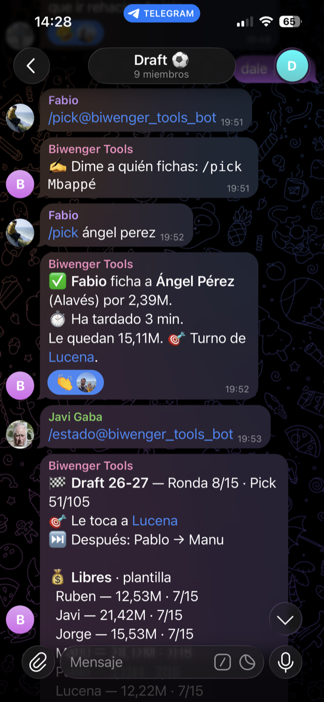
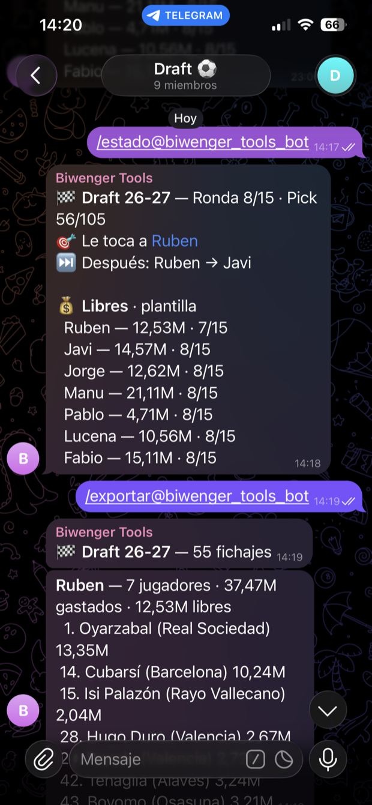
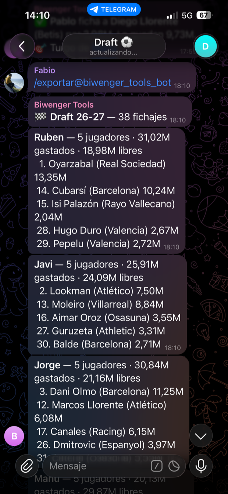

# 📡 Biwenger Tools — Telegram Bot

Cloud Run **Service** (`biwenger-bot`) that receives Telegram webhooks and
calls the [`biwenger-api`](../api/README.md) service over HTTP. Pure
orchestrator — no business logic lives here.

Three audiences are routed by chat id, each with its own command set:

| Chat | Commands |
|---|---|
| The owner's chat (`config.TELEGRAM_CHAT_ID`) | The full admin surface below |
| The draft supergroup (`config.TELEGRAM_DRAFT_CHAT_ID`) | Only the draft commands |
| A chat on the public allowlist (a mate's private chat, or a group the owner opened with him) | Only the public commands: no projection of the owner's team, nothing that acts on it |

Any other chat gets no reply (`200`, so Telegram does not retry). Its message
is only noted by the api, so the owner can authorize it from `/publico`.

## El bot en el grupo

| `/pick` | `/estado` | `/exportar` |
|---|---|---|
| [](docs/01-draft-pick.png) | [](docs/02-draft-estado.png) | [](docs/03-draft-exportar.png) |
| Pide el nombre si falta, valida el turno, aplica el fichaje en Biwenger, cronometra lo que ha tardado y pasa turno. | Ronda, pick global, a quién le toca y el presupuesto y plantilla de los siete. | Vuelca las plantillas completas, presidente a presidente. |

<sub>Capturas del draft 26-27 en vivo.</sub>

## 🗺️ Entry point

`app.py` exposes `POST /telegram/webhook`. The flow per request:

1. Validate `X-Telegram-Bot-Api-Secret-Token` against the stored secret using
   `hmac.compare_digest` (constant-time). 401 if it mismatches.
2. Extract `chat_id` + `text` from the update body. Drop if the chat is not
   one we own.
3. Parse the command via `core.sdk.telegram.parse_command` (strips
   `@botname` suffix, lowercases).
4. Map command → `(api path, http method)` and call `api_client.call_api`
   with a Google-signed ID token.

```
/menu        →  sends an inline-keyboard menu (no api call)
/analizar    →  opens the manager picker (GET /managers, then /teams?manager=<id|all>)
/mercado     →  GET  /market
/alinear     →  POST /lineups/auto-pick
/preview     →  POST /lineups/auto-pick?dry_run=1
/recomendar  →  GET  /budget/recommendations
/pujar       →  POST /market/auto-bid
/comparar    →  POST /league/compare
/saldos      →  POST /league/cash
/top         →  POST /league/top
/ofertas     →  POST /offers/inbox
/emergencia  →  POST /emergency/clausulazo/preview
/pacto       →  GET  /pact, then POST /pact/toggle per tap
/publico     →  GET/POST /public/members (list, add, remove; authorize a waiting chat)
/scrapper    →  POST /scraper/trigger
/version     →  bot SHA + GET /version on biwenger-api
/help        →  static HTML message (no api call)
```

### Public chats

Every message first asks `POST /public/check` (which also remembers an unknown
chat for `/publico`); only an allowlisted chat goes on. Each public endpoint
re-checks the allowlist and answers the chat that asked:

```
/saldos       →  POST /public/league/cash   (no "your best players" block)
/movimientos  →  POST /public/movements     (board trades, clauses, raises; last 24 h)
/analizar     →  POST /public/managers, then /public/teams per tap (rivals only)
/top          →  POST /public/top
/mercado      →  a link to the web's clausulazo page (BIWENGER_WEB_URL)
/ayuda        →  the public help (anything else gets it too)
```

Public reads share a Firestore cache (`public_cache`) across instances, so
repeated taps never reach Biwenger twice in its window.

Inline-keyboard taps come back as `callback_query` updates. They share
the same webhook entry point and dispatch on a `prefix:value`
`callback_data` shape (`menu:<action>`, `analizar:<id|all>`).

### Draft supergroup

Only reachable from `TELEGRAM_DRAFT_CHAT_ID`. Every `/draft/*` response
carries a ready-to-send Spanish `message` — the bot has no draft business
logic of its own, biwenger-api owns all state and player-name matching.

```
/soy [nombre]  →  GET  /draft/managers (no name) or POST /draft/register
/pick <jugador>→  POST /draft/pick (candidates render as buttons on a tie)
/estado        →  GET  /draft/state
/deshacer      →  POST /draft/undo — restricted to the draft admin
/exportar      →  GET  /draft/export
/help          →  static HTML message (no api call)
```

The api processes each request synchronously (build JP index, talk to
Biwenger, render PNG, send to Telegram). The bot is just the HTTP edge.

## 🔐 Auth to biwenger-api

The api is deployed with `--no-allow-unauthenticated`. The bot's runtime SA
has `roles/run.invoker` on `biwenger-api`. `api_client.call_api` uses
`google.oauth2.id_token.fetch_id_token` against the metadata server (no
extra config on Cloud Run) and sends the result as `Authorization: Bearer`.

## 🔑 Secrets

In production: `TELEGRAM_BOT_CONFIG_JSON`, bound to `biwenger-secrets` — the
package's one secret, shared with the api, scraper and web; the bot reads only
these keys:

```json
{
  "bot_token": "...",
  "chat_id": "...",
  "webhook_secret": "...",
  "draft_chat_id": "..."
}
```

`draft_chat_id` is optional — empty disables the draft supergroup entirely.

For local dev, fall back to the same names as plain env vars.

## 📋 Commands, menus and webhook

CI runs `setup_commands.py` after every bot deploy. It registers each command
block for its own chats only: the public block for private chats, the draft
block for the draft group, and the full list for the owner's chat (nothing in
any other group). It refuses to run without the owner's chat id. With
`BIWENGER_BOT_URL` set, it also registers the webhook with
`allowed_updates=["message", "callback_query"]`. **Never register the webhook
by hand with a bare `setWebhook`**: without `callback_query`, Telegram silently
drops every button tap. To run it locally, see
[`../OPERATIONS.md`](../OPERATIONS.md) → *Commands, menu and webhook*.

A group authorized from `/publico` gets the public block scoped to it at that
moment. If the public block changes later, re-register it for the authorized
groups, which the deploy does not do on its own.

## 🚀 Runtime config

Bots run with `cpu=0.5 concurrency=1` (GCP forbids `cpu<1` with
`concurrency>1`). The values are baked into `.github/workflows/deploy.yml`, so
every CI deploy reapplies them — no drift.

`BIWENGER_API_URL` is resolved at deploy time by reading the api service URL
from gcloud and passed as an env var (see `deploy-bot` in the workflow).

See [`OPERATIONS.md`](../OPERATIONS.md) §4 for build/test/deploy commands.
